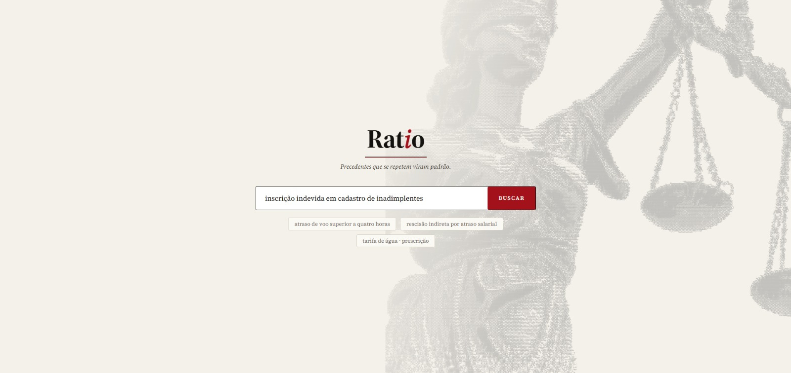

<h2>Sobre mim</h2>


<p align="center"></p>

Meu nome é Isaac Oliveira, sou estudante de Banco de Dados na FATEC São José dos Campos e atualmente estou no quinto semestre do curso.

Atuo na área de desenvolvimento de software ERP, com foco principalmente em aplicações back-end e integração de sistemas. Ao longo do curso, participei de um projeto integrador (API) por semestre, passando de algoritmos em Portugol a uma aplicação desktop em Java, depois a plataformas web com Spring Boot e, no último semestre, a um Data Warehouse jurídico com API em .NET, frontend em React e pipeline de dados em Python.

Busco constantemente evoluir minhas habilidades técnicas e interpessoais, valorizando boas práticas de desenvolvimento, testes automatizados, organização de código, trabalho em equipe e aprendizado contínuo.

## Contatos
* [GitHub](https://github.com/IsaacOliveiraSouza)
* [LinkedIn](https://www.linkedin.com/in/isaac-de-oliveira-841057255/)

## Meus Principais Conhecimentos

**Aplicações e dados**


## Meus Projetos

### Em 2024-2 | API 1º semestre — Calculadora Científica

### Empresa Parceira: FATEC São José dos Campos (projeto interno)

**Papel na equipe:** Desenvolvedor

### Problema:
O primeiro semestre tinha como desafio construir uma solução computacional simples, com foco em algoritmos e lógica de programação. A proposta era reunir, em uma interface de texto no formato de uma calculadora científica, várias operações matemáticas que obrigassem a equipe a aplicar estruturas de decisão, repetição, vetores, funções e validação de entrada.

### Solução Entregue pela Equipe:
A equipe The Buggers desenvolveu uma calculadora científica em Portugol, executada no VisualG, com um menu que permite ao usuário escolher a operação e realizar várias operações na mesma execução. Além das quatro operações básicas, a calculadora resolve fatorial, função de segundo grau, juros simples e compostos, concatenação de strings e conversões entre as bases decimal, binária, octal e hexadecimal. O trabalho foi organizado em três sprints, com o backlog priorizado no ClickUp.

[Repositório do Projeto](https://github.com/IsaacOliveiraSouza/Aplicacao_Projeto_Integragor_Fatec)

#### Principais Funcionalidades

- Interface de texto com menu de escolha das operações.
- Múltiplas operações na mesma execução.
- Operações básicas: adição, subtração, multiplicação e divisão.
- Cálculo de fatorial e de função de segundo grau.
- Juros simples e juros compostos.
- Concatenação de duas strings.
- Conversão de bases: B10 ↔ B2, B2 ↔ B8 e B2 ↔ B16.

#### Tecnologias Utilizadas

> - **Portugol / VisualG**: Linguagem e ambiente usados para escrever e executar os algoritmos da calculadora.
> - **ClickUp**: Utilizado para organizar o backlog e o andamento das sprints.
> - **Git e GitHub**: Utilizados para versionamento e colaboração da equipe.

#### Contribuições Pessoais

<details>
  <summary>Conversões de base numérica</summary>
  <br>

```
procedimento converte_decimal_para_binario()
   var
      i, j: inteiro
      decimal: real
      resultado: vetor[1..100] de inteiro
   inicio
      escreva("Digite um número em base 10: ")
      leia(decimal)
      i <- 1
      enquanto decimal >= 1 faça
         resultado[i] <- decimal % 2
         decimal <- decimal / 2
         i <- i + 1
      fimEnquanto
      limpatela
      escreva("Número em binário: ")
      j <- i - 1
      para i de j até 1 passo -1 faça
         escreva(resultado[i])
      fimPara
      escreval("")
fimprocedimento
```

  Desenvolvi, na terceira sprint, todas as conversões de base numérica da calculadora — decimal ↔ binário, binário ↔ octal e binário ↔ hexadecimal — e o submenu de bases que reúne essas opções. Eram os itens de prioridade alta do backlog, e a conversão de hexadecimal para binário foi a última entrega do projeto.
</details>

<details>
  <summary>Raiz quadrada e acabamento da interface</summary>
  <br>
  Reescrevi o cálculo da raiz quadrada usado pela função de segundo grau, implementando a função <code>RaizQuad</code> por decomposição. Também fiz o polimento do código da calculadora, adicionando a limpeza de tela entre as operações para deixar a navegação pelo menu mais legível.
</details>

#### Hard Skills

- **Lógica de programação**: Sei fazer com autonomia
- **Portugol / VisualG**: Sei fazer com autonomia
- **Git/GitHub**: Sei fazer com autonomia

#### Soft Skills

**Responsabilidade**: Assumi as conversões de base, que eram o bloco de maior prioridade e complexidade da última sprint, e as entreguei antes do fechamento.

**Organização**: Dividi as conversões em procedimentos independentes ligados a um submenu, o que facilitou testar cada uma separadamente.

**Aprendizado contínuo**: O projeto foi meu primeiro contato com versionamento em equipe, e aprendi a integrar meu código ao arquivo compartilhado sem quebrar o que já existia.

### Em 2025-1 | API 2º semestre — Sistema de Gerenciamento de Horários

### Empresa Parceira: FATEC São José dos Campos (projeto interno)

**Papel na equipe:** Desenvolvedor

### Problema:
A montagem da grade de horários de um semestre era feita manualmente pelo coordenador. Cada disciplina tem uma quantidade obrigatória de aulas por semana, cada curso posiciona suas aulas de um jeito e o mesmo professor não pode estar em duas aulas no mesmo horário. Sem uma ferramenta própria, conferir tudo à mão tornava o processo lento e sujeito a conflitos de horário.

### Solução Entregue pela Equipe:
A equipe SINAPSE desenvolveu uma aplicação desktop para que o coordenador da FATEC defina os horários de aula de cada professor. O sistema permite cadastrar cursos, disciplinas, professores e aulas, montar e visualizar a grade horária da semana em tabela e, ao cadastrar uma aula, verifica se ela conflita com outro horário do mesmo professor, sugerindo quais professores estão disponíveis naquele horário. O projeto incluiu a modelagem relacional do banco, manual do usuário e guia de instalação.

<a href="https://github.com/vp-p/gerenciador-horario-aula"></a>

[Repositório do Projeto](https://github.com/vp-p/gerenciador-horario-aula)

#### Principais Funcionalidades

- Visualização da grade de aulas com horários em tabela.
- Cadastro de aulas com verificação de choque de horário do professor.
- Sugestão dos professores disponíveis quando o horário escolhido conflita.
- Cadastro e gerenciamento de cursos, disciplinas e professores.
- Gerenciamento do semestre letivo, vinculando disciplinas ao curso.

#### Tecnologias Utilizadas

<p align="center">
  <a href="https://skillicons.dev">
    
  </a>
</p>

> - **Java**: Utilizado no desenvolvimento de toda a aplicação.
> - **JavaFX e Scene Builder**: Utilizados na construção das telas da aplicação desktop.
> - **Maven**: Utilizado no gerenciamento de dependências e do build.
> - **MySQL e MySQL Workbench**: Utilizados para a modelagem e o armazenamento de cursos, professores, disciplinas e aulas.
> - **Jira**: Utilizado para gestão do backlog e das sprints.
> - **Git e GitHub**: Utilizados para versionamento e colaboração.

#### Contribuições Pessoais

<details>
  <summary>Grade horária funcionando de ponta a ponta</summary>
  <br>
  Na segunda sprint, fiz a grade horária funcionar de ponta a ponta: escrevi o <code>GradeHorariaController</code>, os DAOs de aula, curso, disciplina e professor e as classes de domínio (<code>Aula</code>, <code>Curso</code>, <code>Disciplina</code>, <code>LinhaGrade</code>), ligando a tela da grade ao banco MySQL. Depois, organizei o projeto na estrutura final da aplicação, com as telas de cadastro de curso e de professor.
</details>

<details>
  <summary>Sugestão de professores disponíveis em caso de conflito</summary>
  <br>

```java
List<Integer> professores = buscarProfessoresPorCursoESemestre(aula, semestre);
List<Integer> Ocupados = buscarProfessoresOcupados( aula, professores);

professores.removeAll(Ocupados);

String ids = Ocupados.stream()
        .map(String::valueOf)
        .collect(Collectors.joining(", "));

ProfessorDAO professorDAO = new ProfessorDAO();
List<Professor> disponiveis = professorDAO.buscarProfessores();

String texto = "A aula pode estar conflitando com outros horarios. \n " +
        "Segue os professores disponiveis para esse horario: ";
```

  Na terceira sprint, criei no DAO de aula as consultas que buscam os professores que dão aula para aquele curso e semestre e, entre eles, quais já estão ocupados no horário escolhido. Quando a aula conflita, o sistema não grava e mostra ao coordenador os professores livres para aquele horário. Também ajustei a consulta de professores para receber vários IDs de uma vez com <code>IN</code>.
</details>

<details>
  <summary>Modelagem do banco e correções de integração</summary>
  <br>
  Atualizei as chaves estrangeiras entre as tabelas no modelo do banco. Corrigi a classe <code>Curso</code> e o DAO, que tinham passado a usar subobjetos desnecessários e quebravam a grade já funcionando, e ajustei a conexão e o DAO de disciplina para que os cadastros funcionassem junto com a grade horária.
</details>

#### Hard Skills

- **Java**: Sei fazer com autonomia
- **JavaFX**: Sei fazer com autonomia
- **SQL / MySQL**: Sei fazer com autonomia
- **Modelagem de banco relacional**: Sei fazer com autonomia
- **Git/GitHub**: Sei fazer com autonomia

#### Soft Skills

**Resolução de problemas**: Identifiquei que uma mudança no modelo de `Curso` quebrava a grade que já funcionava e corrigi o modelo e o DAO sem perder o que a equipe tinha feito.

**Visão de produto**: Em vez de apenas bloquear a aula em conflito, propus mostrar ao coordenador os professores livres, o que transformou um erro em uma sugestão útil.

**Colaboração**: Integrei as telas e os DAOs de vários colegas na grade horária, servindo de ponto de encontro entre as partes do sistema.

### Em 2025-2 | API 3º semestre — Proficio

### Empresa Parceira: [ALTAVE](https://www.altave.com.br/)

**Papel na equipe:** Desenvolvedor back-end

### Problema:
A ALTAVE precisava de uma forma mais eficiente de mapear as competências de seus colaboradores. A empresa tinha dificuldade para alocar profissionais em equipes, squads ou demandas específicas porque não possuía uma visão centralizada das skills técnicas, soft skills, certificações, experiências e níveis de proficiência de cada pessoa. Sem uma plataforma estruturada, a identificação de talentos dependia de processos manuais, dificultando a tomada de decisão por parte de diretores e gestores.

### Solução Entregue pela Equipe:
A equipe desenvolveu o Proficio, uma plataforma de mapeamento de competências pensada como um "LinkedIn interno" da empresa. Cada colaborador mantém um perfil profissional com suas competências, enquanto gestores complementam esses perfis com avaliações e diretores visualizam dashboards e métricas gerais. O sistema conta com controle de acesso por perfil, cadastro de colaboradores, equipes, setores e skills, avaliações, autoavaliações e filtros por competência, apoiando a montagem de equipes e a gestão de talentos.

[Repositório do Projeto](https://github.com/Concord-API/API-3) · [Backend](https://github.com/Concord-API/API3-Backend) · [Frontend](https://github.com/Concord-API/API3-Frontend)

#### Principais Funcionalidades

- Perfil individual do colaborador com suas competências.
- Edição dos dados de perfil e listagem de colaboradores.
- Controle de acesso por perfil para diretor, gestor e colaborador.
- Cadastro de gestores, colaboradores, equipes e setores.
- Avaliação de colaboradores e autoavaliação de proficiência.
- Aprovação de novas competências antes de entrarem no sistema.
- Dashboards com métricas de colaboradores, skills, setores e equipes.

#### Tecnologias Utilizadas

<p align="center">
  <a href="https://skillicons.dev">
    
  </a>
</p>

> - **Java e Spring Boot**: Utilizados no backend, com API REST e Spring Data JPA.
> - **Spring Security e JWT**: Utilizados na autenticação e no controle de acesso por perfil.
> - **MySQL**: Utilizado para armazenamento e organização dos dados da plataforma.
> - **React, TypeScript e Tailwind CSS**: Utilizados no desenvolvimento do frontend.
> - **Docker**: Utilizado para padronizar o ambiente.
> - **Git e GitHub**: Utilizados para versionamento, colaboração e revisão de código.

#### Contribuições Pessoais

<details>
  <summary>API de perfil do colaborador</summary>
  <br>
  Na primeira sprint, criei a API que entrega os dados do perfil do usuário — informações do colaborador junto com suas competências —, com os DTOs de resposta e as consultas nos repositories de competência. Aproveitei a entrega para padronizar o pacote <code>domain</code> das entidades e ajustar a configuração de segurança para liberar a rota.
</details>

<details>
  <summary>Edição de perfil e listagem de colaboradores</summary>
  <br>
  Na segunda sprint, desenvolvi as APIs de edição dos dados do perfil e de listagem de colaboradores, criando o <code>PerfilController</code>, os métodos no <code>ColaboradorService</code> e os DTOs e view models de entrada e saída, mantendo a separação entre as camadas de aplicação e apresentação.
</details>

<details>
  <summary>Avaliação de colaboradores e aprovação de competências</summary>
  <br>
  Na terceira sprint, criei a entidade <code>AvaliacaoColaborador</code> e as APIs de criação, atualização e listagem de avaliações, com service, repository, controller e view models próprios. Também adicionei o campo de aprovação à entidade <code>Competencia</code>, para que competências novas entrem no sistema pendentes até serem aprovadas.
</details>

#### Hard Skills

- **Java**: Sei fazer com autonomia
- **Spring Boot**: Sei fazer com autonomia
- **Spring Security**: Sei fazer com auxílio
- **Hibernate / JPA**: Sei fazer com auxílio
- **MySQL**: Sei fazer com autonomia
- **APIs REST**: Sei fazer com autonomia
- **Git/GitHub**: Sei fazer com autonomia

#### Soft Skills

**Comunicação**: Combinei com o frontend o formato dos dados de perfil e de avaliação antes de cada entrega, evitando retrabalho na integração.

**Organização**: Mantive a estrutura em camadas do backend (domain, application, infra e presentation) em todas as funcionalidades que entreguei.

**Trabalho em equipe**: Participei da divisão das tarefas entre backend e frontend e apoiei os colegas na comunicação entre as camadas da aplicação.

### Em 2026-1 | API 4º semestre — Trivio

### Empresa Parceira: [ALTAVE](https://www.altave.com.br/)

**Papel na equipe:** Desenvolvedor back-end e revisor de código

### Problema:
A ALTAVE precisava gerenciar manutenções de equipamentos distribuídos geograficamente, pertencentes a contratos de diferentes clientes. O planejamento das manutenções periódicas, a alocação de técnicos e o acompanhamento das intervenções dependiam de controles manuais, sem considerar de forma integrada a localização dos equipamentos, a recorrência prevista em contrato, a duração estimada e a prioridade das atividades.

### Solução Entregue pela Equipe:
A equipe desenvolveu o Trivio, uma plataforma web de gerenciamento de manutenções. O sistema permite cadastrar clientes, contratos, equipamentos e técnicos, agendar manutenções e acompanhá-las em calendário, lista e mapa. Quando uma manutenção preventiva é concluída, a próxima é gerada automaticamente com base na recorrência do contrato. Os técnicos têm acesso próprio, com agenda, histórico e checklist de execução, e os administradores acompanham o andamento de cada manutenção. O projeto foi entregue em três sprints, com a aplicação publicada online.

[Repositório do Projeto](https://github.com/Concord-API/API-4) · [Backend](https://github.com/Concord-API/API4-Backend) · [Frontend](https://github.com/Concord-API/API4-Frontend)

#### Principais Funcionalidades

- Cadastro e gerenciamento de clientes, contratos, equipamentos e técnicos.
- Cadastro, alteração e consulta de manutenções, com tipo, status e localização.
- Geração automática da próxima manutenção preventiva a partir da recorrência do contrato.
- Calendário e mapa com as manutenções agendadas.
- Área do técnico com agenda e histórico de execução.
- Checklist de execução das manutenções.

#### Tecnologias Utilizadas

<p align="center">
  <a href="https://skillicons.dev">
    
  </a>
  
</p>

> - **Java e Spring Boot**: Utilizados no backend, com API REST, Spring Security, Spring Data JPA e Lombok.
> - **Oracle Database**: Banco de dados relacional da aplicação.
> - **Vue.js e TypeScript**: Utilizados no desenvolvimento do frontend.
> - **Docker e Nginx**: Utilizados para padronizar o ambiente e publicar a aplicação.
> - **Git, GitHub e Jira**: Utilizados para versionamento, revisão de código e gestão das tasks.

#### Contribuições Pessoais

<details>
  <summary>Cadastro de técnicos (Employee)</summary>
  <br>
  Na primeira sprint, criei a entidade <code>Employee</code> com Lombok e as APIs de cadastro, alteração e consulta de técnicos, com controller, service e repository. Também fiz a primeira configuração do Spring Security do backend e reorganizei o pacote de configuração.
</details>

<details>
  <summary>Núcleo de manutenções</summary>
  <br>
  Na segunda sprint, modelei a entidade <code>Maintenance</code> com seus enums de status e de tipo (preventiva/corretiva) e criei uma entidade separada, <code>MaintenanceEmployee</code>, para vincular técnicos às manutenções com <i>soft delete</i>. Em cima disso, desenvolvi as APIs de cadastro, alteração e consulta de manutenções, incluindo o service que gerencia os técnicos alocados em cada uma.
</details>

<details>
  <summary>Localização de manutenções e contratos</summary>
  <br>
  Adicionei os campos de latitude e longitude às entidades de manutenção e de contrato e levei esses dados para os DTOs e services de CRUD, permitindo que o frontend exibisse as manutenções no mapa.
</details>

<details>
  <summary>Checklist de execução</summary>
  <br>
  Na terceira sprint, criei a entidade <code>Checklist</code> e as APIs de inserção e de atualização do checklist das manutenções, usadas pelos técnicos para registrar a execução de cada etapa.
</details>

<details>
  <summary>Correção da geração automática da próxima manutenção</summary>
  <br>

```java
if (existente.getStatus() == MaintenanceStatus.COMPLETED) {
    dto.setNextMaintenanceSuggestion(buildSuggestion(existente));
    // notify observers to create the next maintenance automatically
    maintenancePublisher.notifyObservers(existente);
}

// ...

if (Boolean.TRUE.equals(concluida.getNextGenerated())) {
    throw new ResponseStatusException(HttpStatus.CONFLICT,
            "A próxima manutenção já foi gerada a partir desta");
}
```

  No fechamento do projeto, corrigi a geração automática das manutenções preventivas. Passei a notificar o observer ao concluir uma manutenção, para que a próxima fosse criada no backend, e marquei a manutenção de origem para impedir que a próxima fosse gerada em duplicidade. No frontend, removi a lógica duplicada do modal e ajustei o modal de detalhes do contrato.
</details>

<details>
  <summary>Revisão de código</summary>
  <br>
  Revisei e fiz o merge de mais de 20 Pull Requests da equipe no backend e no frontend ao longo das sprints, mantendo o padrão das entregas.
</details>

#### Hard Skills

- **Java**: Sei fazer com autonomia
- **Spring Boot / Spring Data JPA**: Sei fazer com autonomia
- **Spring Security**: Sei fazer com auxílio
- **Oracle Database**: Sei fazer com autonomia
- **Vue.js**: Sei fazer com auxílio
- **Git/GitHub**: Sei fazer com autonomia

#### Soft Skills

**Responsabilidade**: Assumi o núcleo de manutenções, do modelo de dados às APIs, que era a base de quase todas as outras funcionalidades do sistema.

**Colaboração**: Revisei os Pull Requests da equipe e ajudei os colegas a integrar suas funcionalidades nas entidades que eu tinha criado.

**Resolução de problemas**: Encontrei e corrigi a geração duplicada de manutenções preventivas na reta final, movendo a regra para o backend para que ela não dependesse da tela.

### Em 2026-2 | API 5º semestre — Ratio

**Papel na equipe:** Desenvolvedor full stack e revisor de código

### Problema:
Advogados e juízes gastam muito tempo em uma análise de jurisprudência manual e fragmentada para descobrir como os tribunais estão decidindo sobre uma tese. Sem uma visão consolidada, é difícil avaliar com segurança a aceitação, a recorrência e o grau de consolidação de um entendimento antes de fundamentar uma decisão ou estratégia jurídica.

### Solução Entregue pela Equipe:
A equipe desenvolveu o Ratio, que centraliza jurisprudência, precedentes e doutrina do TJSP, TJRJ, TJMG, STJ e STF em um Data Warehouse jurídico. O usuário descreve o caso em linguagem natural e recebe os temas jurídicos já identificados, ordenados por um score de 0 a 100 que mostra o quão consolidado está o entendimento, acompanhado de um grau na linguagem do meio jurídico (Consolidada, Dominante, Em formação, Divergente). Cada tema mostra o padrão decisório, a evolução ano a ano, o comportamento de cada tribunal e uma amostra auditável dos processos, com todo número rastreável até a fonte e a data de extração. O escopo é a matéria cível, e os dados são carregados por um pipeline Python que alimenta o DW lido pela API.

<a href="https://github.com/Concord-API/API-5"></a>

[Repositório do Projeto](https://github.com/Concord-API/API-5) · [Backend](https://github.com/Concord-API/API5-Backend) · [Frontend](https://github.com/Concord-API/API5-Frontend) · [Pipeline](https://github.com/Concord-API/API5-Pipeline)

#### Principais Funcionalidades

- Busca de temas em linguagem natural, com resultados ordenados pela força do entendimento.
- Score de 0 a 100 com grau em linguagem jurídica.
- Padrão decisório, evolução no tempo e alinhamento por tribunal.
- Escopo de cobertura declarado em todas as telas.
- Amostra auditável dos processos por trás de cada tema.
- Exportação em CSV das decisões que sustentam o tema.
- Acórdãos, precedentes qualificados e doutrina relacionados ao tema.

#### Tecnologias Utilizadas

<p align="center">
  <a href="https://skillicons.dev">
    
  </a>
</p>

> - **C# e .NET**: Utilizados na API, somente leitura, com Dapper e migrations com DbUp.
> - **PostgreSQL**: Banco do Data Warehouse, com busca textual em português (full-text, `unaccent` e `pg_trgm`).
> - **Python**: Utilizado no pipeline de coleta, tratamento e carga dos dados no DW.
> - **React, TypeScript, TanStack Router/Query e Zod**: Utilizados no frontend, com validação dos contratos da API.
> - **xUnit, Testcontainers, Vitest e pytest**: Utilizados nos testes automatizados das três frentes, desenvolvidas com TDD.
> - **Docker e Nginx**: Utilizados para padronizar o ambiente e publicar a aplicação.
> - **Git e GitHub**: Utilizados para versionamento, revisão de código e integração contínua.

#### Contribuições Pessoais

<details>
  <summary>Busca de temas no Data Warehouse</summary>
  <br>

```sql
ALTER TABLE dw.dim_theme
    ADD COLUMN search_vector tsvector GENERATED ALWAYS AS (to_tsvector('dw.pt_unaccent'::regconfig, theme_name)) STORED,
    ADD COLUMN theme_name_norm text GENERATED ALWAYS AS (dw.norm_pt(theme_name)) STORED;

CREATE INDEX idx_dim_theme_fts ON dw.dim_theme USING gin (search_vector);

CREATE INDEX idx_dim_theme_name_trgm ON dw.dim_theme USING gin (theme_name_norm gin_trgm_ops);
```

  Na primeira sprint, criei a base da busca de temas: as colunas geradas com o vetor de busca e o nome normalizado sem acentos, os índices GIN de texto completo e de trigramas e a função <code>dw.top_themes</code>, que devolve os temas de maior volume quando a busca está vazia. Na API, a busca rejeita consultas com menos de 3 caracteres e devolve 404 para tema inexistente, e os testes garantem que um tema de alto volume, mas dividido, fique abaixo de um tema consistente.
</details>

<details>
  <summary>Escopo de cobertura declarado (US-24)</summary>
  <br>
  Implementei o escopo de cobertura de ponta a ponta: no backend, o <code>ScopeReader</code> lê os tribunais da dimensão de tribunais e o <code>DeclaredScope</code> monta a frase do escopo, devolvida junto com a lista de temas e com o detalhe do tema. No frontend, validei o escopo nas respostas, criei o componente que o exibe abaixo do cabeçalho de resultados e no rodapé do tema e fiz a página de limitações ler o escopo da API. Também escrevi um teste que falha se alguma tela escrever o nome de um tribunal à mão, para que o escopo nunca fique desatualizado em relação aos dados.
</details>

<details>
  <summary>Grau do entendimento (US-07)</summary>
  <br>
  Fiz a API só devolver o grau do entendimento quando o tema tem o mínimo de casos julgados, com testes nas fronteiras de cada faixa, e mostrei o grau ao lado do score na lista de resultados e no cabeçalho do tema, mantendo apenas o score quando o mínimo não é atingido.
</details>

<details>
  <summary>Amostra auditável de processos (US-15)</summary>
  <br>
  Na segunda sprint, criei o cliente da amostra de processos com o contrato validado em Zod e a tabela auditável que mostra órgão julgador, data e resultado de cada processo por trás do tema, com teste garantindo que a ordem da amostra seja a mesma entre chamadas.
</details>

<details>
  <summary>Exportação em CSV (US-27)</summary>
  <br>
  Na terceira sprint, entreguei a exportação das decisões do tema em CSV: as linhas saem na mesma ordem da tela, o arquivo é cortado em um teto de 10.000 linhas declarado no próprio arquivo e o teto é devolvido junto com a amostra, para que a tela avise quando o tema ultrapassa esse limite.
</details>

<details>
  <summary>Carga dos acórdãos do STJ no pipeline</summary>
  <br>
  No pipeline Python, implementei a coleta dos espelhos de acórdãos do STJ das turmas cíveis, lendo tanto os arquivos mensais quanto o zip histórico, gravando-os na camada raw e permitindo rodar a coleta pela linha de comando ou a partir de uma pasta local. Depois, fiz a carga desses acórdãos no Data Warehouse com a ementa como publicada e liguei a etapa à execução do pipeline, atualizando o schema de testes com as migrations da API.
</details>

<details>
  <summary>Revisão de código</summary>
  <br>
  Revisei e fiz o merge de 25 Pull Requests da equipe no backend e no frontend durante as sprints.
</details>

#### Hard Skills

- **C# / .NET**: Sei fazer com auxílio
- **PostgreSQL**: Sei fazer com autonomia
- **Modelagem dimensional / Data Warehouse**: Sei fazer com auxílio
- **Python**: Sei fazer com autonomia
- **React / TypeScript**: Sei fazer com auxílio
- **Testes automatizados (TDD)**: Sei fazer com autonomia
- **Git/GitHub**: Sei fazer com autonomia

#### Soft Skills

**Visão de ponta a ponta**: Entreguei histórias completas, do banco à tela, como o escopo de cobertura e a exportação em CSV, reduzindo a dependência entre as frentes do projeto.

**Disciplina**: Desenvolvi com TDD em todas as frentes, sempre escrevendo o teste antes da implementação, o que deixou cada regra do produto protegida contra regressões.

**Autodidatismo**: Aprendi .NET, Dapper, busca textual no PostgreSQL e o domínio jurídico durante o semestre para atender às demandas do projeto.
